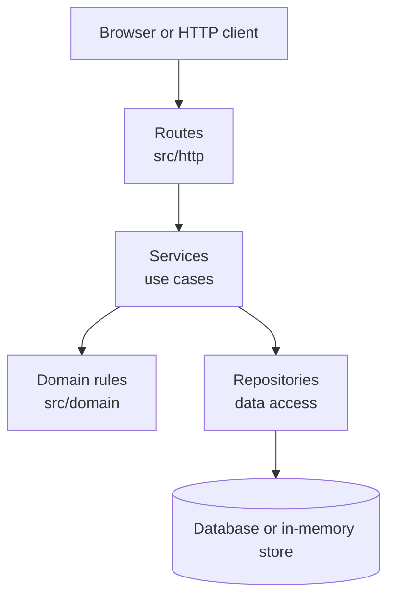
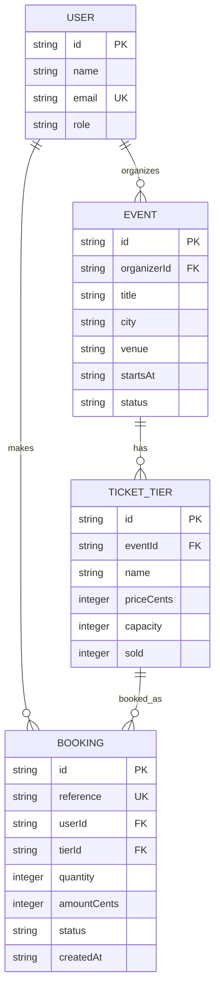
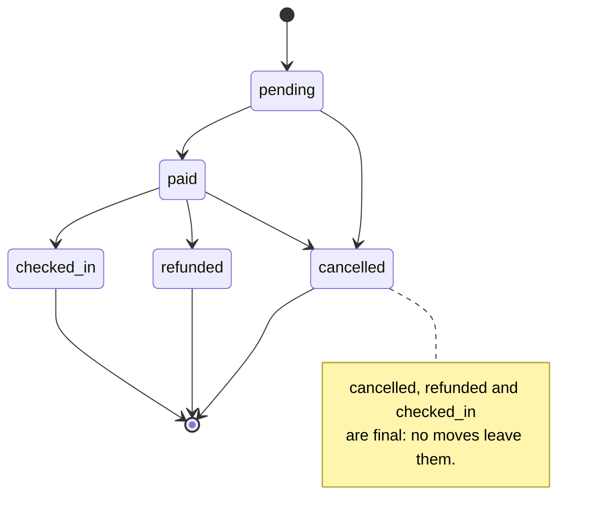

# Architecture

The application is layered. Dependencies point downwards only: routes call services, and services call domain rules and repositories. Nothing calls upwards.

## Layers

- **Routes** may read HTTP requests, validate transport-level details, call services and map results or errors to HTTP responses. They may not contain business rules or reach into repositories or storage directly.
- **Services** may orchestrate one use case at a time by calling domain rules and repositories. They may not know about HTTP, request objects or response objects.
- **Domain rules** may enforce invariants, calculations and state transitions using plain data. They may not perform I/O, use HTTP, or read and write storage.
- **Repositories** may read and write the database or in-memory store. They may not contain business rules or call services, routes or HTTP code.

## Data model

Money is stored as whole cents. A booking belongs to one user and one ticket tier. A tier belongs to one event, and an event belongs to one organizer.

## Booking life cycle

A new booking starts as `pending`. It may be paid or cancelled. A paid booking may be checked in, refunded or cancelled. `cancelled`, `refunded` and `checked_in` are final states.
